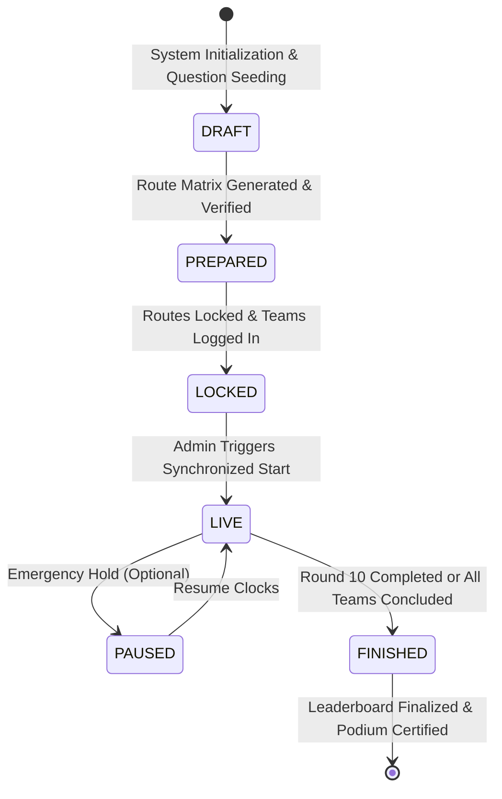
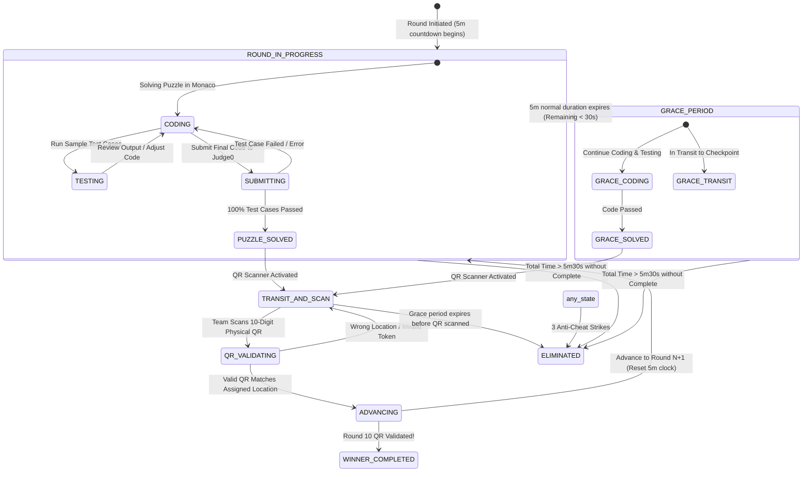

# GAME FLOW & STATE MACHINE — TREASURE HUNT ARENA

## 1. Global Competition Lifecycle

---

## 2. Team Round Progression State Machine

Each of the 20 teams progresses through an independent state machine instance synchronized to authoritative server clocks:

---

## 3. Strict Timing & Grace Period Logic

Every round has two distinct timing phases calculated strictly on the backend:

1. **Normal Window ($0 \le t \le 300\text{s}$)**:
   - Round progress bar displays green/blue.
   - Team has full freedom to solve code and traverse to the physical checkpoint.
   - If puzzle is solved within 300s, team continues to checkpoint.

2. **Grace Window ($300\text{s} < t \le 330\text{s}$)**:
   - UI switches to high-urgency amber/red styling with an audible countdown warning.
   - Both puzzle submission and QR scan remain fully accepted by the backend API.
   - If a team solves their code at second 305 and scans their assigned QR at second 325, the round successfully completes and advances.

3. **Hard Expiration ($t > 330.000\text{s}$)**:
   - The backend background scheduler / database trigger fires.
   - Any pending submissions are rejected with HTTP 410 Gone (`DEADLINE_EXCEEDED`).
   - Team status is set to `eliminated`.
   - Client is permanently locked out of the competition arena.

---

## 4. Balanced Route Allocation Algorithm Details

### 4.1 Construction via Shifted Latin Hypercube
To guarantee that:
- Every team visits each of the 10 locations exactly once ($10 \times 10$ round permutations).
- Every round has exactly $20 / 10 = 2$ teams at each location.

We utilize a paired cyclic shift generator:
1. Divide the 20 teams into two groups of 10:
   - $\text{Group A} = \{T_1, \dots, T_{10}\}$
   - $\text{Group B} = \{T_{11}, \dots, T_{20}\}$
2. Apply a randomized permutation of location IDs $\{L_{\pi(1)}, \dots, L_{\pi(10)}\}$.
3. For Group A, assign Location for team $i$ at round $r$ as:
   $$\text{Loc}(T_i, r) = \pi\big((i + r - 2) \pmod{10} + 1\big)$$
4. For Group B, apply an independent orthogonal offset shift $\delta$ (coprime to 10):
   $$\text{Loc}(T_{10+j}, r) = \pi\big((j + 3r - 2) \pmod{10} + 1\big)$$
5. Verify orthogonality to ensure:
   $$\forall r \in [1, 10], \forall l \in [1, 10], \quad |\{t \mid \text{Loc}(t, r) = l\}| = 2$$

### 4.2 Route Pre-Generation & Verification
- Prior to match start, the Admin generates the candidate route matrix.
- The system runs automated verification assertions:
  - Assert 1: $\sum_{t} \mathbb{I}(\text{Loc}(t, r) = l) = 2$ for all $(r, l)$.
  - Assert 2: Set of locations for each team equals $\{1, \dots, 10\}$.
- The verified matrix is permanently locked and written to `team_routes`.

---

## 5. Anti-Cheat Event Handling & Debouncing

1. **Client Event Interceptors**:
   - `visibilitychange`: Triggers when tab is swapped or browser minimized.
   - `window.blur`: Triggers when focus leaves window (e.g., alt-tabbing to Discord/IDE).
   - `fullscreenchange`: Triggers when user exits requested full-screen mode.
2. **Debounce & Jitter Filter**:
   - Multiple blur/visibility events occurring within a 3-second window are coalesced into a single incident to prevent accidental multi-strike penalties from single OS window-snapping animations.
3. **Escalation Protocol**:
   - Strike 1: Informational modal on player screen ("Warning 1/3: Focus lost. Maintain fullscreen.").
   - Strike 2: Severe warning modal with red flashing perimeter ("Final Warning 2/3: Next violation will terminate your team.").
   - Strike 3: Terminal event. Team disqualified, socket disconnected.

---

## 6. Real-Time Station Occupancy Engine

- The backend calculates real-time station crowding dynamically based on team phase:
  - **Occupant (Active Scanner)**: Team has solved the round puzzle and is currently authorized to scan at location $L$.
  - **Approaching**: Team is in the last 60 seconds of their coding round for location $L$.
- The Admin dashboard renders an interactive 10-station topological map:
  - Color-coded pins (Green: 0-1 teams, Yellow: 2 teams, Red: 3+ teams due to pacing differences).
  - Marshal dispatch alerts if congestion or transit bottlenecks occur.
